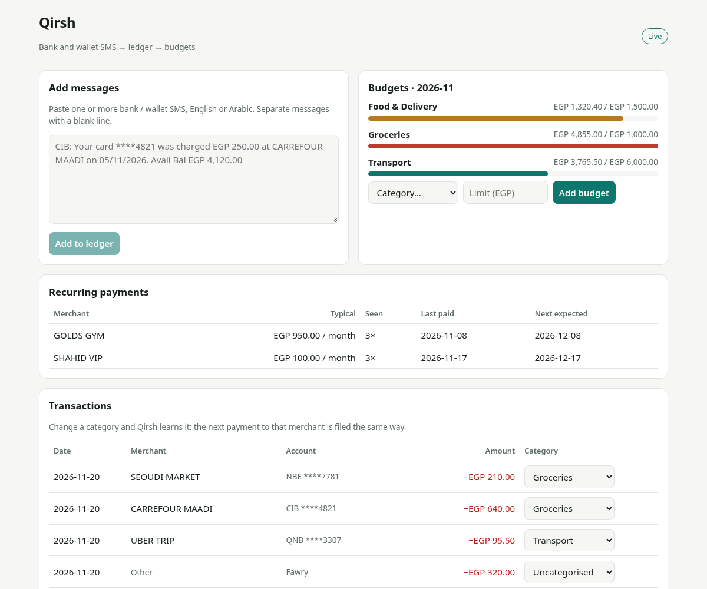
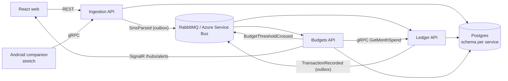

# Qirsh

[](https://github.com/ahmedoshelmy/qirsh/actions/workflows/ci.yml)
[](LICENSE)
[](https://dotnet.microsoft.com/)
[](#architecture)
[](src/Web)

Part of the [systems portfolio](https://github.com/ahmedoshelmy/systems-portfolio).

**Egyptian bank and wallet SMS → a clean ledger → monthly budgets with live alerts.**

Egyptian banks and wallets tell you about every payment by SMS, in English or Arabic, in a dozen formats.
Qirsh turns those messages into a ledger: paste or forward them, and it reads the amount, direction, merchant,
card and balance, files each transaction under a category it learned from you, tracks monthly budgets and pushes a
live alert to the browser when a category crosses 80% or 100%. Self-hosted, free, one `docker compose up`.

*(Qirsh — قرش — is the Egyptian word for a piaster, and for money in general.)*



## What it does

- **Bilingual SMS grammar** – CIB, NBE, QNB, Banque Misr, Banque du Caire, AAIB, HSBC, InstaPay, Vodafone Cash,
  Etisalat Money, Orange Cash, WE Pay, Fawry. English and Arabic, Arabic-Indic digits, day-first and yearless dates,
  balance vs amount, fees and limits skipped, OTP and declined messages ignored.
- **Idempotent ledger** – the same SMS pasted twice is one transaction.
- **Categories that learn** – shipped keywords (`TALABAT` → Food & Delivery); move a transaction once and the next
  payment to that merchant is filed the same way.
- **Budgets with alerts** – 80% and 100% thresholds, each announced once per month, pushed over SignalR.
- **Mid-month budgets** are back-filled from the ledger over gRPC.
- **Recurring payments** – subscriptions and bills found in the ledger (same merchant, steady weekly / monthly /
  quarterly / yearly rhythm, amount within 15%), with the next expected date and an overdue flag.

## Architecture

Three services (bounded contexts), one Postgres with a schema per service, RabbitMQ in between.



| Service | Owns | In | Out |
|---|---|---|---|
| **Ingestion** | raw messages (hash-deduplicated) | `POST /api/sms`, gRPC `SmsParser.Parse/ParseBatch` | `SmsParsed` |
| **Ledger** | accounts, transactions, categories, merchant rules | `SmsParsed`, `PUT /api/transactions/{id}/category` | `TransactionRecorded`, `TransactionRecategorised`, gRPC `LedgerQuery.GetMonthSpend` |
| **Budgets** | budgets, applied transactions | `TransactionRecorded`, `TransactionRecategorised`, `POST /api/budgets` | `BudgetThresholdCrossed`, SignalR `budgetAlert` |

Each service follows Clean Architecture (`Domain` → `Application` → `Infrastructure` → `Api`); the SMS parser is a
pure domain function with no dependencies. An architecture test enforces the dependency rule and that no bounded
context references another.

```
src/
  Qirsh.Contracts/          messages + protos (sms_parser.proto, ledger_query.proto)
  Qirsh.ServiceDefaults/    OpenTelemetry, health checks, ProblemDetails, MassTransit outbox/inbox, transport switch
  Ingestion/  Domain (SmsParser) · Infrastructure (EF Core, intake) · Api (REST + gRPC)
  Ledger/     Domain · Application (command handlers, query port) · Infrastructure (EF Core, consumer) · Api (REST + gRPC)
  Budgets/    Domain · Application · Infrastructure (EF Core, consumers, gRPC client) · Api (REST + SignalR)
  Web/        React + Vite + TypeScript, TanStack Query, @microsoft/signalr
tests/        unit tests per context, architecture tests, Testcontainers integration tests
```

## Quickstart

Requirements: Docker (or Podman with the Docker CLI).

```bash
cp .env.example .env            # optional: change passwords
docker compose up -d --build --wait
# open http://localhost:8080 and paste an SMS, add a budget
./scripts/smoke.sh              # end-to-end check from the command line
docker compose down -v
```

Demo data: set `QIRSH_DEMO_DATA=true` in `.env` before the first start to ingest the 46 invented messages in
`seed/sms-samples.json`. Traces: `docker compose --profile obs up -d` with
`OTEL_EXPORTER_OTLP_ENDPOINT=http://aspire-dashboard:18889`, then open http://localhost:18888.

### Local development

```bash
docker compose up -d postgres rabbitmq
dotnet run --project src/Ledger/Qirsh.Ledger.Api        # :5201 REST, :5202 gRPC
dotnet run --project src/Ingestion/Qirsh.Ingestion.Api  # :5101 REST, :5102 gRPC
dotnet run --project src/Budgets/Qirsh.Budgets.Api      # :5301
cd src/Web && npm install && npm run dev                # :5173, proxies to the services
```

### Tests

```bash
dotnet test Qirsh.slnx          # unit + architecture + Testcontainers (needs Docker)
cd src/Web && npm test
```

The integration tests start Postgres and RabbitMQ in containers, host the three services in-process and check
the main flow end to end: an SMS posted to Ingestion becomes a Ledger transaction, updates the budget and arrives
as a SignalR alert; a duplicate SMS stays one transaction; a budget created after spending is back-filled over gRPC
and not double counted.

## API sketch

```http
POST /api/sms                     { "text": "CIB: Your card ****4821 was charged EGP 250.00 at CARREFOUR MAADI ..." }
POST /api/sms/preview             parse only, nothing stored
GET  /api/transactions?month=2026-11
PUT  /api/transactions/{id}/category   { "category": "Shopping" }     -> learns the merchant
GET  /api/recurring               subscriptions and bills, next expected date
GET  /api/categories · POST /api/categories · GET /api/rules
GET  /api/budgets?month=2026-11 · POST /api/budgets { "category": "Groceries", "limit": 4000 }
PUT  /api/budgets/{id}/limit
WS   /hubs/alerts                 server -> client "budgetAlert"
```

Errors are RFC 7807 `ProblemDetails`. `/health/live` and `/health/ready` (database + broker) on every service.

## Interview talking points (design notes)

1. **Why an outbox.** A crash between `SaveChanges()` and `Publish()` either loses a money event or, with naive
   retries, sends it twice. The EF Core transactional outbox makes the publish part of the same database
   transaction; consumers run behind an inbox keyed by message id, and every step also has a natural key (SMS
   hash, `(account, hash)`, applied transaction id). At-least-once delivery, exactly-once effect.
   ([ADR 2](docs/adr/0002-transactional-outbox-and-inbox.md))
2. **gRPC for queries, events for facts.** Spending flows as events. "How much did Groceries already spend this
   month?" is a question asked once, when a budget is created mid-month — a deadline-bound gRPC call with a
   graceful fallback beats replaying history into a service that just started. The reply carries the counted
   transaction ids so in-flight events for them are ignored. ([ADR 3](docs/adr/0003-grpc-for-queries-events-for-facts.md))
3. **Parsing messy bilingual SMS as a pure function.** The grammar is a set of small rules (amount, direction,
   date, balance, counterparty, account digits) in `Qirsh.Ingestion.Domain`, table-tested with 45+ invented
   English and Arabic messages, kept out of infrastructure so the same code can run behind REST, gRPC or on a phone.
4. **Schema per service, one database.** Ownership without three servers; each service has its own migrations
   history and outbox tables and can move to its own server by changing a connection string.
   ([ADR 4](docs/adr/0004-schema-per-service.md))
5. **A real bug found by a real test.** MassTransit caches outbox lock SQL per entity type in a static map; with
   schema-per-service and several services in one test process the first schema won and other services polled the
   wrong table. The Testcontainers test caught it; the fix is one option, documented in ADR 2.
6. **Recurring payments without a scheduler.** Detection is a pure domain function over the read side
   (group by merchant + currency, gaps must all fit one cadence window, amounts within 15% of the median), run
   on request. No new tables, no background job, nothing to keep in sync — and every rule is a unit test.
7. **Transport switch.** `Messaging__Transport=RabbitMq|AzureServiceBus` — same consumers, same outbox; RabbitMQ
   locally, Service Bus in Azure.

## Azure (optional)

`infra/main.bicep` describes Azure Container Apps (consumption), Postgres Flexible Server (B1ms) and Service Bus.
Deployment is manual and optional (Service Bus Standard, needed for topics, is not free); CI only compiles the Bicep.
It has not been deployed: the Ledger's internal gRPC port (5202) would still need an `additionalPortMappings`
entry, and the images need pushing to a registry first.

## Status

MVP. Single user, no authentication (self-hosted on your own machine or network). Stretch ideas: YARP gateway,
Android companion that reads SMS and calls the gRPC intake, optional free-LLM
categoriser for merchants no rule knows (off by default), CSV export.

Known limits: two genuinely identical SMS (same text, same balance) are treated as one; amounts in other
currencies are recorded but budgets count only their own currency.

## Extracted from Lingo

Qirsh is extracted from **Lingo**, a private personal-assistant app, where the SMS grammar and budget alerts were
first written in TypeScript. This repository is a clean re-implementation in .NET with a fresh history and
invented sample data only.

## License

[MIT](LICENSE)
